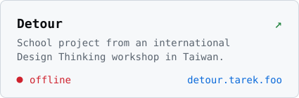

<picture>
  <source media="(prefers-color-scheme: dark)" srcset="./img/header-dark.svg" />
  
</picture>

<h3><code>tarek@github ~ $ neofetch</code></h3>

<picture>
  <source media="(prefers-color-scheme: dark)" srcset="./img/neofetch-dark.svg" />
  
</picture>

<h3><code>tarek@github ~ $ ls projects/</code></h3>

<!-- One line per linked card: GitHub underlines links, so any whitespace inside <a> shows up as a stray underline. -->

<a href="https://bikelytics.run.place"><picture><source media="(prefers-color-scheme: dark)" srcset="./img/project-bikelytics-dark.svg" /></picture></a>
<a href="https://tarek.foo"><picture><source media="(prefers-color-scheme: dark)" srcset="./img/project-portfolio-dark.svg" /></picture></a>
<a href="https://ichbinhier.work.gd"><picture><source media="(prefers-color-scheme: dark)" srcset="./img/project-ichbinhier-dark.svg" /></picture></a>
<a href="https://detour.tarek.foo"><picture><source media="(prefers-color-scheme: dark)" srcset="./img/project-detour-dark.svg" /></picture></a>
<a href="#tarekgithub---ls-projects"><picture><source media="(prefers-color-scheme: dark)" srcset="./img/project-navo-dark.svg" /></picture></a>

<picture>
  <source media="(prefers-color-scheme: dark)" srcset="./img/projects-caption-dark.svg" />
  
</picture>

<h3><code>tarek@github ~ $ ./how-it-runs.sh</code></h3>

<picture>
  <source media="(prefers-color-scheme: dark)" srcset="./img/diagram-dark.svg" />
  
</picture>

