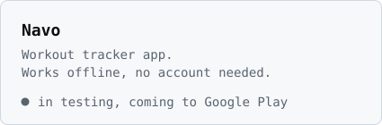

<picture>
  <source media="(prefers-color-scheme: dark)" srcset="./img/header-dark.svg" />
  
</picture>

<h3><code>tarek@github ~ $ neofetch</code></h3>

<picture>
  <source media="(prefers-color-scheme: dark)" srcset="./img/neofetch-dark.svg" />
  
</picture>

<h3><code>tarek@github ~ $ ls projects/</code></h3>

<a href="https://bikelytics.run.place"><picture>
  <source media="(prefers-color-scheme: dark)" srcset="./img/project-bikelytics-dark.svg" />
  
</picture></a>
<a href="https://tarek-elhussain.vercel.app"><picture>
  <source media="(prefers-color-scheme: dark)" srcset="./img/project-portfolio-dark.svg" />
  
</picture></a>
<a href="https://ichbinhier.work.gd"><picture>
  <source media="(prefers-color-scheme: dark)" srcset="./img/project-ichbinhier-dark.svg" />
  
</picture></a>
<a href="#tarekgithub---ls-projects"><picture>
  <source media="(prefers-color-scheme: dark)" srcset="./img/project-navo-dark.svg" />
  
</picture></a>

<picture>
  <source media="(prefers-color-scheme: dark)" srcset="./img/projects-caption-dark.svg" />
  
</picture>

<h3><code>tarek@github ~ $ ./how-it-runs.sh</code></h3>

<picture>
  <source media="(prefers-color-scheme: dark)" srcset="./img/diagram-dark.svg" />
  
</picture>

<h3><code>tarek@github ~ $ open</code></h3>

<a href="https://www.linkedin.com/in/tarek-elhussain-0b0990354"><picture>
  <source media="(prefers-color-scheme: dark)" srcset="./img/link-linkedin-dark.svg" />
  
</picture></a>

